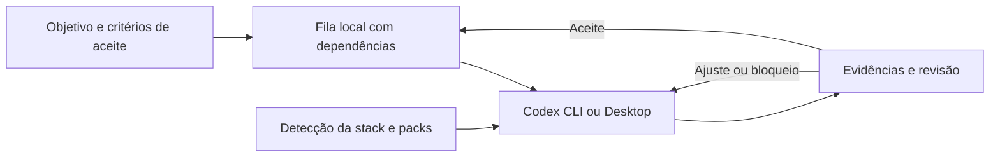

<h1 align="center">Coding Agent Harness</h1>
<p align="center"><strong>Orquestração de agentes para engenharia de software, da ideia à operação.</strong></p>
<p align="center">
  
  
  
</p>
<p align="center"><a href="#como-rodar">Como rodar</a> · <a href="#arquitetura">Arquitetura</a> · <a href="#segurança-de-skills">Segurança de skills</a> · <a href="#validação">Validação</a></p>

## O que é o Coding Agent Harness?

Uma camada de orquestração para transformar uma ideia em software verificável. Ela orienta o Codex e o Claude Code a definir a primeira entrega, construir a jornada principal e preparar a publicação. Pode trabalhar sobre um site público, um SaaS, uma API, um CLI ou um sistema existente.

**Edição 4.1.** Inclui instalação por projeto para Codex e Claude Code, um fluxo da ideia ao MVP e execução por lotes com limites configuráveis. A documentação histórica conserva os nomes das edições anteriores.

## O que ele entrega?

| Área | Como o harness ajuda |
| --- | --- |
| Produto e arquitetura | Define o problema, recorta a primeira entrega e registra critérios observáveis. |
| Design e implementação | Aciona perfis de UX, frontend, backend e dados conforme a stack e o escopo. |
| QA, segurança e operação | Orienta testes, revisão de permissões, triagem de dependências e instrumentação. |
| Continuidade | Mantém a fila, os resultados da execução e o aceite com evidência local. |

A biblioteca reúne **28 perfis de agentes**, **12 skills essenciais** e **49 especialidades locais em 21 packs**. O bootstrap instala só quatro skills para começar. Adicione os perfis e packs úteis conforme o projeto crescer.

## Arquitetura



| Caminho | Responsabilidade |
| --- | --- |
| [`agents/`](agents/) e [`.agents/skills/`](.agents/skills/) | Perfis e skills essenciais. |
| [`specialties/`](specialties/) e [`catalog/`](catalog/) | Packs por área, stack e atividade. |
| [`scripts/engineering.py`](scripts/engineering.py) | Fila persistente, execução, registro, retomada e aceite. |
| [`workflow-skills/`](workflow-skills/) e [`third-party/`](third-party/) | Workflows e skills externas revisadas com revisão e hashes fixados. |

## Como rodar

Você precisa de **Python 3.11+**, **Git** e uma conta autenticada no **Codex** ou no **Claude Code**. O exemplo abaixo usa um projeto existente. Consulte o [guia do primeiro projeto](docs/38-primeira-entrega.md) se estiver começando em uma pasta vazia.

```powershell
git clone https://github.com/Breno-J-Oliveira/coding_agent_harness.git
cd coding_agent_harness
$projeto = "C:\Projetos\meu-app"
python scripts/bootstrap.py --target $projeto --engine both
python scripts/bootstrap.py --target $projeto --engine both --apply
```

Abra o projeto no seu agente. No Codex, comece com `$idea-to-release`. No Claude Code, use `/idea-to-release`. Cole sua ideia e descreva quem vai usar, qual problema quer resolver e onde pretende executar o software. Quatro skills locais bastam para começar. Os perfis e packs adicionais ficam disponíveis quando o trabalho precisar deles.

### Deixe o Codex preparar o MVP

A fila fica fora do projeto. `start` cria a primeira entrega a partir da ideia. `run` inicia uma sessão que refina o escopo, implementa a menor jornada viável e prepara evidências e instruções de release. Os comandos são executados na pasta deste repositório.

```powershell
$fila = Join-Path $env:USERPROFILE "Documents/meu-app-fila.json"
python scripts/engineering.py --board $fila start --project $projeto --idea "Portal para clientes agendarem serviços sem telefonar"
python scripts/engineering.py --board $fila run --timeout 1800
python scripts/engineering.py --board $fila status
python scripts/engineering.py --board $fila usage
```

Use `brief` para levar a tarefa ao Codex Desktop ou Claude Code quando preferir uma sessão interativa. O [guia do primeiro projeto](docs/38-primeira-entrega.md) explica `advance`, verificadores de confiança, instalação de dependências, limites de tokens e passagem para deploy.

### Criar uma fila persistente

Guarde a fila fora do repositório. O exemplo parte de um projeto Git existente e usa PowerShell.

```powershell
$fila = Join-Path $env:USERPROFILE "Documents/meu-app-fila.json"
python scripts/engineering.py --board $fila init --project $projeto --goal "Entregar cadastro de clientes"
python scripts/engineering.py --board $fila add cadastro --phase backend --title "Implementar cadastro" --acceptance "Dados válidos persistem e dados inválidos retornam erro"
python scripts/engineering.py --board $fila add jornada --phase qa --title "Validar cadastro pelo navegador" --acceptance "O cadastro funciona e os dados persistem" --after cadastro
python scripts/engineering.py --board $fila next
python scripts/engineering.py --board $fila run
python scripts/engineering.py --board $fila status
```

Depois de conferir a evidência, use `accept cadastro --evidence CAMINHO` com a mesma fila. Para uma tarefa executada no Desktop, use `record cadastro --evidence CAMINHO` antes do aceite. O [guia de operação](docs/36-engineering-os.md) cobre configuração de modelo, retomada e seleção de packs.

## Segurança de skills

O [`skill-guard.py`](scripts/skill-guard.py) executa o Cisco AI Defense Skill Scanner localmente. O relatório apoia a revisão de procedência, licença, conteúdo e hashes antes da ativação. A fila mantém os logs fora do repositório e exige aceite para liberar dependências. Consulte a [política de segurança](SECURITY.md).

## Validação

```powershell
python scripts/validate-package.py
python scripts/skillpacks.py validate
python scripts/check-docs.py
python -m unittest discover -s tests
```

A suíte inclui instalação em ambos os agentes, preservação de configuração, retomada, bloqueio por falha de verificação, aceite e orçamento de tokens. Em uma máquina onde o sandbox da CLI estiver indisponível, use o caminho interativo com `brief` e `record`. Para afirmar economia de tokens, compare duas execuções equivalentes pelo aceite e pelo consumo observado. [Resultados no GitHub Actions](https://github.com/Breno-J-Oliveira/coding_agent_harness/actions) · [Relatório da edição 4.0](docs/37-validacao-v4.md)

## Documentação

- [Guia de operação](docs/36-engineering-os.md)
- [Catálogo de especialidades](docs/31-catalogo-de-especialidades.md) e [ativação por stack](docs/33-instalar-skills-por-stack.md)
- [Pesquisa comparativa e decisões de projeto](docs/35-pesquisa-v4.md)
- [Contribuição](CONTRIBUTING.md), [histórico](CHANGELOG.md) e [licença MIT](LICENSE)
