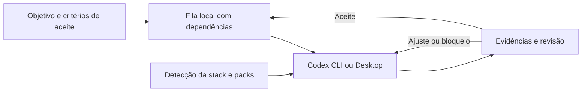

<h1 align="center">Coding Agent Harness</h1>
<p align="center"><strong>Orquestração de agentes para engenharia de software, da ideia à operação.</strong></p>
<p align="center">
  
  
  
</p>
<p align="center"><a href="#como-rodar">Como rodar</a> · <a href="#arquitetura">Arquitetura</a> · <a href="#segurança-de-skills">Segurança de skills</a> · <a href="#validação">Validação</a></p>

## O que é o Coding Agent Harness?

Uma camada de orquestração ao redor do Codex para transformar uma ideia em tarefas com critérios de aceite. Ela sugere especialistas e skills conforme o projeto, registra dependências e mantém o progresso entre sessões. Funciona sobre a stack do repositório, de um site público a um SaaS, uma API, um CLI ou um sistema legado.

Este repositório publica a evolução do VibeCoder Engineering OS 4.0 sob o nome **Coding Agent Harness**. A documentação histórica conserva os nomes das edições anteriores.

## O que ele entrega?

| Área | Como o harness ajuda |
| --- | --- |
| Produto e arquitetura | Define o problema, recorta a primeira entrega e registra critérios observáveis. |
| Design e implementação | Aciona perfis de UX, frontend, backend e dados conforme a stack e o escopo. |
| QA, segurança e operação | Orienta testes, revisão de permissões, triagem de dependências e instrumentação. |
| Continuidade | Mantém a fila, os resultados da execução e o aceite com evidência local. |

A edição reúne **28 perfis de agentes**, **12 skills essenciais**, **49 especialidades locais em 21 packs** e **quatro skills adicionais** para entrega, triagem, simplificação de código e observabilidade. Ative apenas os packs úteis para o projeto.

## Arquitetura



| Caminho | Responsabilidade |
| --- | --- |
| [`agents/`](agents/) e [`.agents/skills/`](.agents/skills/) | Perfis e skills essenciais. |
| [`specialties/`](specialties/) e [`catalog/`](catalog/) | Packs por área, stack e atividade. |
| [`scripts/engineering.py`](scripts/engineering.py) | Fila persistente, execução, registro, retomada e aceite. |
| [`workflow-skills/`](workflow-skills/) e [`third-party/`](third-party/) | Workflows e skills externas revisadas com revisão e hashes fixados. |

## Como rodar

Requisitos para a instalação local e a fila: **Python 3.11+** e **Git**. Use o **Codex Desktop** para conduzir o trabalho em uma sessão ou o **Codex CLI autenticado** para executar a próxima tarefa pela fila.

```powershell
git clone https://github.com/Breno-J-Oliveira/coding_agent_harness.git
cd coding_agent_harness
$projeto = "C:\Projetos\meu-app"
python scripts/devkit.py plan --scope project --target $projeto --profile full
python scripts/devkit.py install --scope project --target $projeto --profile full --apply
python scripts/install-engineering-skills.py --target $projeto --apply
python scripts/skillpacks.py recommend --target $projeto
```

Abra o projeto no Codex e peça: **“Use `$engineering-delivery` para transformar este objetivo em entregas verificáveis e execute a primeira tarefa.”**

### Criar uma fila persistente

Guarde a fila fora do repositório. O exemplo parte de um projeto Git existente e usa PowerShell.

```powershell
$fila = Join-Path $env:USERPROFILE "Documents/meu-app-fila.json"
python scripts/engineering.py --board $fila init --project $projeto --goal "Entregar cadastro de clientes"
python scripts/engineering.py --board $fila add cadastro --phase backend --title "Implementar cadastro" --acceptance "Dados válidos persistem e dados inválidos retornam erro"
python scripts/engineering.py --board $fila add jornada --phase qa --title "Validar cadastro pelo navegador" --acceptance "O cadastro funciona e os dados persistem" --after cadastro
python scripts/engineering.py --board $fila next
python scripts/engineering.py --board $fila run
python scripts/engineering.py --board $fila status
```

Depois de conferir a evidência, use `accept cadastro --evidence CAMINHO` com a mesma fila. Para uma tarefa executada no Desktop, use `record cadastro --evidence CAMINHO` antes do aceite. O [guia de operação](docs/36-engineering-os.md) cobre configuração de modelo, retomada e seleção de packs.

## Segurança de skills

O [`skill-guard.py`](scripts/skill-guard.py) executa o Cisco AI Defense Skill Scanner localmente. O relatório apoia a revisão de procedência, licença, conteúdo e hashes antes da ativação. A fila mantém os logs fora do repositório e exige aceite para liberar dependências. Consulte a [política de segurança](SECURITY.md).

## Validação

```powershell
python scripts/validate-package.py
python scripts/skillpacks.py validate
python scripts/check-docs.py
python -m unittest discover -s tests
```

A validação da edição 4.0 encontrou 60 testes aprovados e 2 ignorados. No teste real com Codex CLI, o sandbox do Windows bloqueou a escrita. A fila registrou a falha e o fluxo de retomada com evidência externa foi verificado. A economia de tokens por entrega ainda precisa de medição comparativa. [Relatório de validação](docs/37-validacao-v4.md)

## Documentação

- [Guia de operação](docs/36-engineering-os.md)
- [Catálogo de especialidades](docs/31-catalogo-de-especialidades.md) e [ativação por stack](docs/33-instalar-skills-por-stack.md)
- [Pesquisa comparativa e decisões de projeto](docs/35-pesquisa-v4.md)
- [Contribuição](CONTRIBUTING.md), [histórico](CHANGELOG.md) e [licença MIT](LICENSE)
