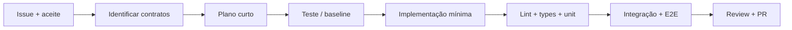

# 03 — Engenharia full stack profissional

## Princípio

O agente não deve “reescrever tudo”. Ele deve descobrir o stack, identificar limites de contexto, mudar o menor conjunto de arquivos capaz de atender os critérios de aceite e **provar** o resultado com testes.

## Frente a frente: escolhas de skills

| Camada | Skill / origem | Uso | Ferramentas de prova |
|---|---|---|---|
| React / Next | [`vercel-react-best-practices`](https://github.com/vercel-labs/agent-skills) | Render, data fetching, bundle, streaming | React Profiler, Lighthouse, testes |
| Vue 3 | [`vue`](https://github.com/antfu/skills) | Composition API, SFC, reatividade | `vue-tsc`, Vitest |
| Design de componentes | [`composition-patterns`](https://github.com/vercel-labs/agent-skills) | Componentes flexíveis, evitar prop proliferation | Testes de componente |
| Arquitetura / fluxo | [`spec-driven-development`](https://github.com/addyosmani/agent-skills) | Uma especificação para guiar implementação | Critérios de aceite |
| Revisão | [`code-review-and-quality`](https://github.com/addyosmani/agent-skills) | Revisão de 5 dimensões | Relatório por diff |
| TDD | [`tdd`](https://github.com/mattpocock/skills) | Red/green/refactor | Testes falhando→passando |
| Bugs | [`diagnosing-bugs`](https://github.com/mattpocock/skills) | Hipótese, reprodução, regressão | Teste mínimo reproduzível |
| Postgres | [`supabase-postgres-best-practices`](https://github.com/supabase/agent-skills) | RLS, índices, transações | EXPLAIN, testes de políticas |
| Browser | [`Playwright CLI`](https://github.com/microsoft/playwright-cli) | Jornadas e screenshots | Trace + screenshot + assert |
| Produção | [`Sentry for AI`](https://github.com/getsentry/sentry-for-ai) | Instrumentação e triagem | Event ID, stack trace, métricas |

## Pipeline para uma feature

**Back-end:** defina entradas/saídas, status HTTP, validação no servidor, autorização por recurso, idempotência quando cabível, paginação, timeouts, logs, limites de taxa e tratamento de falha. Nunca tratar autenticação como sinônimo de autorização.

**Front-end:** HTML semântico, forms com labels, rotas resilientes, estados de espera/erro, divisão de bundles apropriada, cache consciente, imagens responsivas e métricas por rota.

**Banco:** migrações versionadas, backup e restauração testável, índices com base em consultas, restrições no banco, transações e menor privilégio. Teste políticas entre usuários/tenants.

## Suites de qualidade por stack

| Stack | Testes e verificações sugeridos |
|---|---|
| TS/Node/Nest | `tsc --noEmit`, ESLint, Vitest/Jest, Supertest, dependency audit, Playwright |
| React/Next | ESLint, TypeScript, Testing Library, Playwright, Lighthouse CI |
| Python/FastAPI | Ruff, mypy (se adotado), pytest, httpx, audit de dependências |
| PHP | PHPStan/Psalm, PHPUnit/Pest, Composer Audit, testes de integração |
| PostgreSQL | Testes de migration/rollback, políticas RLS, `EXPLAIN (ANALYZE, BUFFERS)` em ambiente de testes |
| Docker | Build isolado, scan de imagem, usuário não-root, healthcheck, secrets fora da imagem |

> **Não transforme esta tabela em comandos obrigatórios indiscriminadamente.** Detecte o repositório e use o gerenciador e scripts realmente existentes. `npm audit` e equivalentes podem retornar avisos não exploráveis; priorize evidência de impacto e versões afetadas.

## Contratos antes da implementação

Criar `/docs/api-contracts.md` ou OpenAPI quando existir API com múltiplos consumidores. Incluir nomes estáveis, exemplos de payload, erro estruturado, autenticação, paginação, limites e versão. Frontend pode desenvolver com mocks fiéis ao contrato enquanto backend implementa endpoints separados; integração exige testes reais sem mock.

## Arquitetura por necessidade

- Pequeno projeto: aplicação simples e módulos claros, sem camadas artificiais.
- SaaS médio: serviços coesos, contratos, testes, filas/eventos apenas quando necessários.
- Alto risco: threat model, fronteiras de domínio, auditoria e observabilidade desde o design.
- Refatoração: medir, isolar, cobrir comportamento, mudar em fatias e comparar.

## Processo de revisão antes do merge

1. O diff corresponde exatamente ao escopo autorizado?
2. Houve alteração de autenticação, migração, schema ou segredo?
3. Testes novos demonstram a funcionalidade e um cenário de falha?
4. Houve mudanças silenciosas de API ou performance?
5. O front trata estados, teclado e responsividade?
6. Os logs evitam PII, senhas e tokens?
7. O PR registra evidência e rollback quando necessário?

## Recomendação especial para seu ecossistema

Para muitos projetos com React, NestJS, Python e PHP, instale **globalmente** apenas habilidades horizontais (`code-review`, `diagnosing-bugs`, `tdd`). Instale **por projeto** `vercel-react-best-practices`, Vue e banco específico. Isso reduz acionamentos irrelevantes e instruções conflitantes.

**Fontes:** [Vercel](https://github.com/vercel-labs/agent-skills), [Addy Osmani](https://github.com/addyosmani/agent-skills), [Matt Pocock](https://github.com/mattpocock/skills), [Supabase](https://github.com/supabase/agent-skills), [Anthony Fu](https://github.com/antfu/skills).
