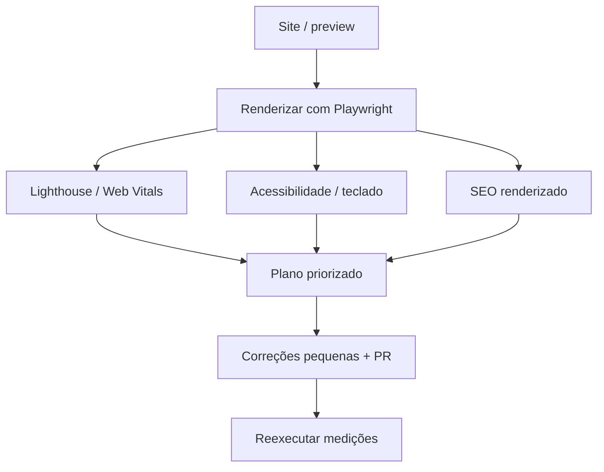

# 05 — SEO, performance, acessibilidade e observabilidade

## Skills recomendadas

A coleção [Corey Haines / Marketing Skills](https://github.com/coreyhaines31/marketingskills) oferece `seo-audit`, `schema`, `site-architecture`, `ai-seo`, `analytics`, `cro` e `programmatic-seo`. Instale apenas o subconjunto aplicável.

```powershell
npx skills add coreyhaines31/marketingskills --list
npx skills add coreyhaines31/marketingskills --skill seo-audit --skill schema-markup --skill site-architecture -a codex
```

## Checklist técnico SEO

| Grupo | Verificação | Evidência |
|---|---|---|
| Descoberta | sitemap.xml, robots.txt, links internos, HTTP 200 | Crawl e Search Console |
| Indexação | `noindex`, canonical, URLs duplicadas, redirect chains | Inspeção de URL |
| HTML | `<title>`, meta description, headings, lang | HTML renderizado |
| Conteúdo | intenção de busca, originalidade, autoridade e utilidade | Revisão editorial |
| Dados estruturados | JSON-LD correto por tipo e conteúdo | Rich Results Test |
| Mobile | Layout, UX, leitura, interação touch | Testes em viewport |
| International | hreflang/URLs/idiomas somente se aplicável | Crawl e configuração |
| Performance | LCP, INP, CLS, tamanho de assets | CrUX/RUM/Lighthouse |
| Medição | Search Console + analytics orientada a objetivos | Séries históricas |

**Não prometer ranking no Google.** SEO precisa de conteúdo útil, indexação e evidências; não existe um plugin capaz de garantir posições. Google não usa a meta-tag `keywords` para ranqueamento e rejeita táticas que tentem manipular pesquisa.

## Core Web Vitals

- **LCP**: maior elemento de conteúdo visível; referencial de experiência boa até **2,5s**.
- **INP**: latência de interação; referencial de experiência boa até **200ms**.
- **CLS**: estabilidade visual; referencial de experiência boa até **0,1**.

Avalie resultados reais em dados de campo quando disponíveis, normalmente no percentil 75. Lighthouse é um laboratório, útil para identificar regressões e hipóteses, **não** substitui medição de usuários reais.

## Lighthouse CI

Fonte: [GoogleChrome/lighthouse-ci](https://github.com/GoogleChrome/lighthouse-ci). Ele permite executar auditorias por PR e verificar orçamentos de performance. O workflow deste repositório valida somente documentação; **não** deve ser aplicado ao código de um site sem adaptar build/rotas.

Exemplo conceitual para um projeto que já tem servidor adequado:

```bash
npm run build
npx @lhci/cli autorun
```

Antes, configure URL, processo de inicialização, budgets e número de execuções em `lighthouserc` conforme o stack. Evite exigir `score >= 100` em toda rota; use orçamentos plausíveis e controle de regressões.

## Auditoria integrada



## Alertas e Sentry

Instalar [Sentry for AI](https://github.com/getsentry/sentry-for-ai) só se houver necessidade de observabilidade e acesso ao serviço. Coletar erros com IDs de evento, traces e tags não sensíveis; mascarar dados pessoais; testar amostragem; garantir que falhas relevantes gerem alertas e possam ser investigadas. Definir ambiente, versão e release health.

## SEO para SaaS ≠ SEO para landing page

- **Landing page:** indexação, título, H1, mensagens claras, produto demonstrado, links internos e performance.
- **SaaS logado:** páginas privadas **não** devem aparecer em busca; foco SEO em páginas públicas, docs e blog, se existirem.
- **E-commerce:** variantes, canonicals, estoque, facetas e schema próprio.
- **Site multilíngue:** hreflang, retorno, URLs e conteúdo realmente traduzido.
- **SEO programático:** só quando cada página tem valor próprio e dados originais; evitar conteúdo quase duplicado em massa.

**Fontes:** [Google SEO Starter Guide](https://developers.google.com/search/docs/fundamentals/seo-starter-guide?hl=pt), [Guia de SEO para desenvolvedores](https://developers.google.com/search/docs/fundamentals/get-started-developers), [Web Vitals](https://web.dev/articles/vitals), [Lighthouse CI](https://github.com/GoogleChrome/lighthouse-ci), [Corey Haines](https://github.com/coreyhaines31/marketingskills).
