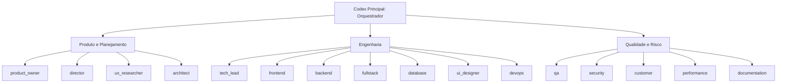

# 06 — Orquestração multiagente: empresa virtual sem teatro corporativo

## Organização

O ecossistema possui 22 **papéis cadastráveis**; normalmente somente 0–3 subagentes são instanciados por tarefa. Além dos 16 papéis de origem, há `file_scout`, `docs_scout`, `test_triage`, `integration_reviewer`, `seo` e `accessibility`. O Codex principal é o orquestrador e tem responsabilidade final sobre integração e evidências.



## Catálogo de papéis

| Papel | Entrada | Entrega exigida | Quando acionar |
|---|---|---|---|
| director | Objetivo, risco, custo, prazo | Decisão e trade-offs; **não simula autoridade real** | Decisão estratégica complexa |
| product_owner | Ideia, usuários e problema | Escopo, aceites, prioridade | Feature de produto |
| tech_lead | Plano e arquitetura | Delegação, merge, revisão | Integração multiarquivo |
| architect | Requisitos não funcionais | ADR e proposta comparada | Escolha estrutural |
| frontend | Contratos, componentes, design | Código + testes de UI | Telas e estados |
| backend | Endpoints, regras, autorização | Código + testes de API | Domínio e serviços |
| fullstack | Fatia vertical isolada | Fluxo ponta a ponta | Feature independente |
| database | Esquema e consultas | Migration + rollback + EXPLAIN/testes | Persistência |
| ui_designer | Marca, componentes, referências | Tokens, layout e critérios visuais | Identidade e consistência |
| ux_researcher | Jornada, perfis, tarefas | Heurísticas e hipóteses | Fluxos e acessibilidade |
| qa | Critérios e ambiente | Plano de testes + evidências | Pré-merge |
| security | Superfícies e regras de acesso | Achados reproduzíveis e mitigação | Mudança de risco |
| customer | Persona e cenários | Feedback simulado claramente rotulado | Protótipos e discovery |
| devops | Infra, deploy e rollback | Pipeline, configuração e validação | Infra / release |
| performance | Métrica basal, profiler | Gargalo e ganho medido | Regressão / lentidão |
| documentation | Mudança e decisão | README, ADR e runbook | Alteração pública ou operacional |

**Cliente simulado ≠ pesquisa real com usuários.** O agente `customer` é uma técnica de avaliação hipotética e não deve produzir “dados de usuários” inventados.

## Política de despacho

| Nível | Regra | Exemplo |
|---|---|---|
| S0 — trivial | Principal sozinho | Ajustar texto, corrigir typo |
| S1 — normal | Principal e 1 especialista, se útil | Bug de validação |
| S2 — paralelo | Até 2 especialistas com fronteiras distintas | Backend e frontend com contrato fixado |
| S3 — crítico | Até 3 especialistas em fases + revisão separada | Autenticação, pagamentos, migração |

**Motivos para NÃO criar subagentes:** passos sequenciais, tarefa de uma função, mesmo arquivo compartilhado, contextos insuficientemente definidos, saída menor do que o custo do handoff.

## Protocolo de delegação

Modelo obrigatório de tarefa delegada:

```text
PAPEL: backend
OBJETIVO: implementar endpoint POST /api/invoices
ESCOPO: apps/api/src/billing/** (não editar outras pastas)
ENTRADAS: docs/FEATURE_SPEC.md, contrato OpenAPI
CRITÉRIOS DE ACEITE: status HTTP, autenticação, autorização, idempotência
RESTRIÇÕES: sem alterar ambiente de produção nem schema sem planejar
VALIDAÇÃO: testes unitários e integração existentes
SAÍDA: arquivos alterados, comandos executados, resultados, riscos e pendências
```

### Handoff de no máximo 10 linhas

```text
RESULTADO: concluído / parcial / bloqueado
ALTERAÇÕES: caminhos + resumo
TESTES: comando + exit code
EVIDÊNCIAS: screenshot/trace/log com path
PENDÊNCIAS: o que falta e por quê
RISCOS: severidade + impacto
DECISÕES: ADR ou motivo
PRÓXIMA AÇÃO: passo específico
```

## Isolamento e sincronização

- Em uma mesma worktree, **somente um agente edita cada arquivo por vez**.
- Usar tarefas independentes ou Git worktrees quando realmente necessário; merges continuam centralizados.
- Não deixar agentes rebasearem/commitarem indiscriminadamente uma branch compartilhada.
- Evitar que o revisor modifique o mesmo código enquanto o implementador ainda edita.
- Uma entrega só é “pronta” com testes executados e resultados registrados.

## Exemplo de comando no Codex

> Planeje esta feature em cinco linhas. Delegue somente se existirem dois fluxos realmente independentes. Se puder, use `frontend` para interface e `backend` para API com contrato fixado antes. Reserve `qa` para validar o resultado integrado; `security` entra apenas se houver autenticação, autorização, dados sensíveis ou superfície de ataque nova. Nunca compartilhe edição do mesmo arquivo. Entregue diff, testes executados, riscos e o que ficou fora do escopo.

## Configuração

Arquivos globais em `~/.codex/agents/` ou por projeto em `.codex/agents/`; cada TOML independente precisa de `name`, `description` e `developer_instructions` no formato atual. Os agentes herdam permissões, provider e servidores MCP do pai. Configuração base em [`templates/config-agents.toml`](../templates/config-agents.toml). Consulte sempre [Subagents — documentação oficial](https://learn.chatgpt.com/docs/agent-configuration/subagents).
