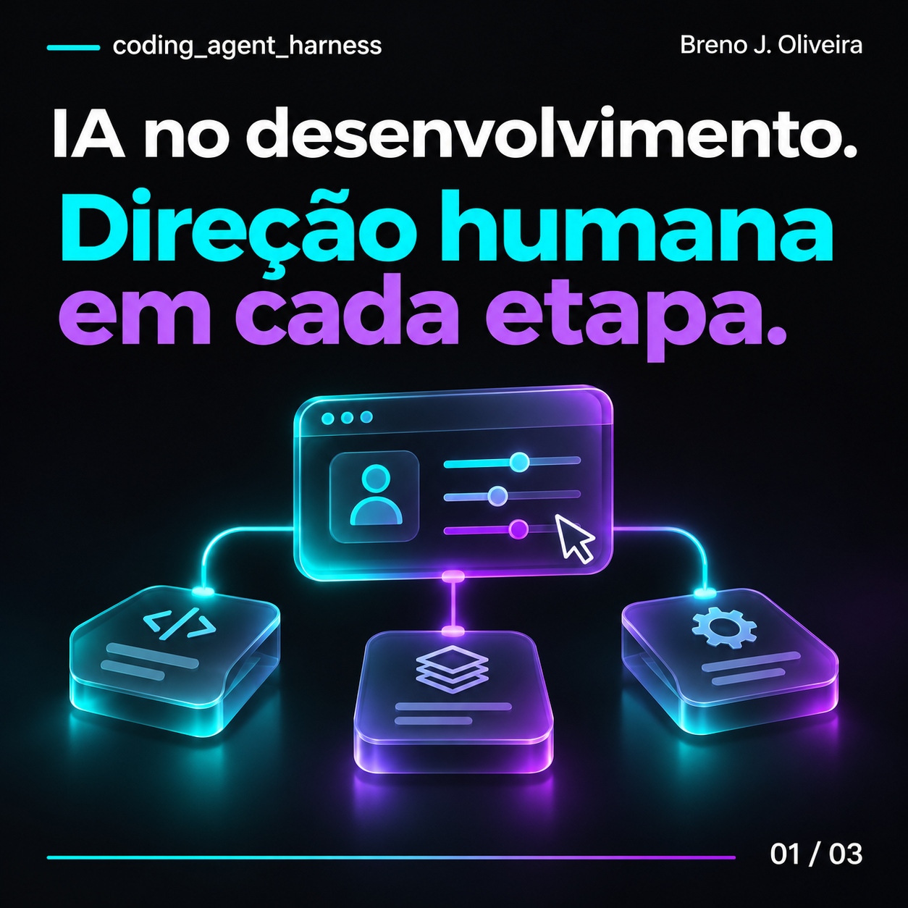

# Apresentação para LinkedIn

Artes conceituais de divulgação do Coding Agent Harness. Não são capturas da aplicação nem resultados de benchmark.

## Ordem do carrossel

1. [Capa](01-capa.png) — IA no desenvolvimento, com direção humana.
2. [Processo](02-processo.png) — problema, planejamento, implementação, testes e revisão.
3. [Full Stack](03-fullstack.png) — áreas apoiadas e critérios de aceite.

As artes foram geradas com IA e revisadas visualmente para esta apresentação.

## Texto da publicação

A IA passou a fazer parte da minha rotina de desenvolvimento. Mas produtividade exige mais do que gerar código rápido.

Em pouco tempo, essas ferramentas ganharam espaço no mercado e mudaram a forma como pesquisamos, implementamos e revisamos software. Para quem busca entregas ágeis, aprender a usá-las com critério se tornou uma competência importante.

Foi nesse contexto que organizei o coding_agent_harness: uma estrutura para melhorar minha produção com IA, com instruções claras, responsabilidades definidas e etapas de verificação.

Peguei inspiração em práticas compartilhadas por outros desenvolvedores e adaptei essas ideias ao meu jeito de trabalhar e às necessidades dos meus projetos. As referências estão documentadas no repositório.

A proposta é apoiar o desenvolvimento Full Stack de ponta a ponta: da interface às APIs e ao banco de dados, incluindo testes, segurança, documentação e preparação da entrega.

Meu objetivo é reduzir trabalho repetitivo, organizar melhor o contexto e tornar a assistência da IA mais útil em cada etapa. Também estabelecer critérios para avaliar o que foi produzido antes de incorporar uma alteração ao projeto.

A participação humana continua no centro desse processo.

Entender o problema, definir prioridades, avaliar decisões de arquitetura, revisar código e validar o comportamento do sistema continuam sendo responsabilidades de quem desenvolve. Uma resposta convincente da IA, sozinha, não comprova que uma solução funciona.

O projeto também é um exercício de evolução da minha própria forma de trabalhar: aprender com a comunidade, experimentar e ajustar o processo conforme encontro evidências do que funciona.

Como vocês estão incorporando IA ao desenvolvimento sem perder o cuidado com a qualidade das entregas?

https://github.com/Breno-J-Oliveira/coding_agent_harness

#DesenvolvimentoDeSoftware #InteligenciaArtificial #FullStack #Produtividade #EngenhariaDeSoftware
